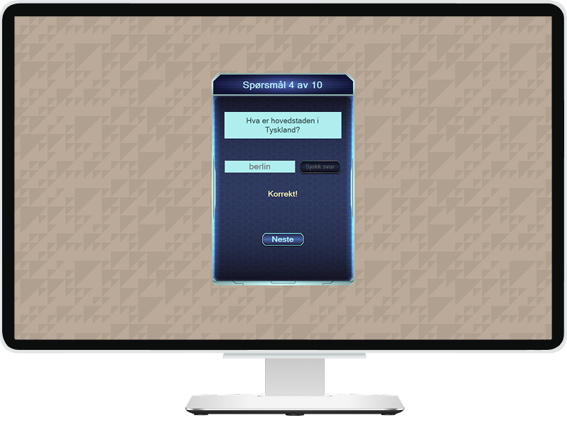

# Project name: Quiz

### Project Goal: Desktop Applikasjon

Forsøk å implementere en desktop app, dette bør helst være en enkel console app.
Ettersom vi ikke har hatt noen type gjennomgang av C# GUI utvikling, men, det er mulig å bruke f.eks Windows Forms,
CORE etc om man ønsker å sette seg inn i det og lære det på egenhånd, men merk at arkitektur er tyngre i C# enn i f.eks JavaScript.

## 💎 Description

"QuizFormApp" is a simple quiz application built using Windows Forms. This project serves as an assignment for learning the fundamentals of C# GUI development. Although prior tutorials on C# GUI programming were not covered in the course, the project emphasizes self-learning through the use of Windows Forms and similar frameworks.

### 🧩 Tech Stack

<!-- end:tech-stack -->
